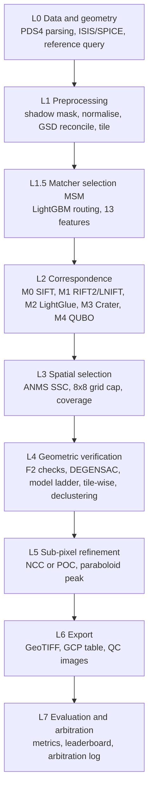
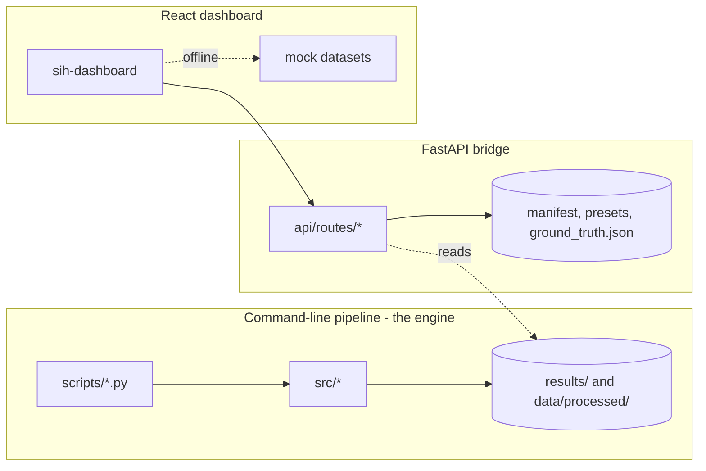

# 01 — System Architecture

## 1. Design principles

1. **Benchmark first, no universal matcher.** Several matchers sit behind one
   interface (`BaseMatcher`) and are compared per terrain and illumination
   stratum. SIFT always runs as the floor and the fallback.
2. **Gates and fallbacks everywhere.** Each stage has a numeric gate. A failure
   is written to `results/failures.jsonl` with the fallback taken, and the
   pipeline continues with a safer option.
3. **Coordinates are `(col, row)`.** Enforced by assertions at call boundaries
   (for example in `MatchResult.__post_init__`).
4. **Only ground-truth points marked `eval` count.** Fit and QC points never
   enter reported metrics; train and test splits are disjoint by geographic cell.
5. **Everything is traceable.** Every artifact JSON carries provenance: config
   hash, matcher parameter hash, git commit, seed (`src/provenance.py`).
6. **Optional features never change the baseline.** (Design intent for the
   quantum layer: with it disabled the output must equal the classical pipeline.)

## 2. Layers



| Layer | Source | Script(s) |
|-------|--------|-----------|
| L0 | `src/ingest/label_parser.py`, `src/ingest/reference.py` | `scripts/ingest.py`, `scripts/build_pairs.py`, `scripts/fetch_lroc_nac.py` |
| L1 | `src/preprocessing/{masks,normalize,resample,branches,tiling,stats}.py` | `scripts/preprocess.py` |
| L1.5 | `src/selector/{features,model}.py` | `scripts/train_msm.py` |
| L2 | `src/matching/{sift,rift,lnift,lightglue,crater,iirs}.py`, `quantum/matcher_qubo.py` | `scripts/benchmark.py` |
| L3 | `src/selection/{anms,spatial}.py` | `scripts/benchmark.py` |
| L4 | `src/registration/{checks,ladder,tilewise,declustering}.py` | `scripts/run_s6_s7.py` |
| L5 | `src/refinement/local.py` | `scripts/run_s6_s7.py` |
| L6 | (export code) | `scripts/register.py` |
| L7 | `src/evaluation/*` | `scripts/evaluate_pairs.py` and the evaluation modules |

## 3. Three runtime surfaces

The same repository exposes three separate ways to run, and they are **not** the
same code path.



- **Engine (CLI).** Real processing. Reads `data/…`, writes `results/…`.
- **API.** Serves dataset lists, images, crops, science diagnostics, configs and
  metrics to the dashboard. The upload route can run a real SIFT + MAGSAC++ match
  (📄 per `CHANGES.md`). The `/api/pipeline/run` route does **not** call the engine ⚠️.
- **Dashboard.** Displays globe, targets, alignment, results and the quantum tab.
  If the backend is unreachable it falls back to embedded mock data (📄 README).

## 4. Repository map

```text
Voyage-modify1/
├── api/                     FastAPI app (server.py + routes: config, datasets, metrics, pipeline, science, quantum)
├── src/
│   ├── ingest/              PDS4 label parser, ISIS invocation, reference acquisition
│   ├── preprocessing/       masks, normalisation, resampling, sensor-pair branches, tiling
│   ├── matching/            base contract + sift, rift (RIFT2), lnift, lightglue, crater, iirs
│   ├── selector/            MSM feature extraction and routing model
│   ├── selection/           ANMS-SSC and spatial uniformity selection
│   ├── registration/        F2 checks, model ladder, tile-wise models, GCP declustering
│   ├── refinement/          sub-pixel refinement (NCC/POC + paraboloid)
│   ├── evaluation/          metrics, aggregation, arbitration, leakage audit, MSM eval, synthetic eval, system validation
│   ├── synthetic/           anchor extraction and physical transform engine
│   ├── failures.py          append-only gate-failure log
│   └── provenance.py        hashes, git commit, seeds
├── quantum/                 quantum subsystem (see quantum/ docs)
├── scripts/                 stage entry points, benchmarks, data tools, verification suites
├── synthetic/               extra synthetic-data assets
├── configs/                 YAML configuration (default, sensor pairs, matchers, msm, quantum, pqc public key)
├── models/                  msm_v1.pkl, msm_v1_stats.json, crater_yolov9.pt
├── data/                    metadata, spec samples, sample images; large data git-ignored
├── tests/                   pytest suites
├── sih-dashboard/           React + Vite + TypeScript + Tailwind + Cesium dashboard
├── docs/                    this documentation set
└── AUDIT.md FLOWS.md CHANGES.md progress.md README.md Dockerfile Procfile railway.json vercel.json requirements*.txt environment.yml
```

Size at review time (lines): `src` 12.3k, `api` 4.1k, `quantum` 6.2k, `scripts` 11.1k,
`tests` 6.5k, `sih-dashboard/src` 13.9k.

## 5. Stage and state model

Stages S1–S9 produce artifacts in a fixed order (see `03_PIPELINE_STAGES.md`).
A pair moves through these states, and a re-run resumes from the deepest
artifact that already exists (📄 `PIPELINE.md` §5 of the previous set; the
`--resume` and `--force` flags exist in `scripts/benchmark.py` ✅):

`EMPTY → MATCHED → SELECTED → VERIFIED → REFINED → REGISTERED → EVALUATED`

## 6. Cross-cutting services

| Service | Module | Behaviour |
|---------|--------|-----------|
| Failure log | `src/failures.py` | Append-only `failures.jsonl`: `pair_id, matcher, stage, reason, fallback_taken, created_at, extra` |
| Provenance | `src/provenance.py` | `hash_config`, `hash_matcher_params`, `get_code_commit`, `set_global_seed`, `build_provenance` |
| Leakage audit | `src/evaluation/leakage_audit.py` | Verifies geo-cell disjointness and GT placement; exits with code 4 on failure |
| Arbitration log | `src/evaluation/arbitration.py` | One entry per pair: winning matcher and the reason |

## 7. Extension points

- **New matcher:** subclass `BaseMatcher` (`src/matching/base.py`), return a
  `MatchResult` (arrays `src_xy`, `ref_xy`, `confidence`, optional `scale`,
  `angle_deg`, plus `runtime_s`, `matcher_params`), add a block to
  `configs/matchers.yaml`, register it in the benchmark runner and the API
  allow-list.
- **New sensor pair:** add a `configs/<pair>.yaml` that `extends: default`, and a
  preprocessing branch in `src/preprocessing/branches.py`.
- **New API route group:** add `api/routes/<name>.py` and include its router in `api/server.py`.
