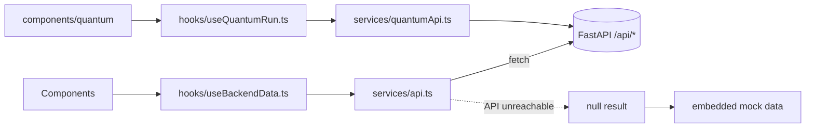

# 06 — Dashboard

`sih-dashboard/` is a single-page React application ("mission control") with a
landing page and a registration workbench. Not built in this review (no
`node_modules`); structure and behaviour below come from reading the source 📄
except where marked ✅.

## 1. Stack

| Concern | Choice |
|---------|--------|
| Framework | React 19, TypeScript (~6.0), Vite 8 |
| Styling | Tailwind CSS 3, custom dark "obsidian + emerald" theme |
| 3D | `three`, CesiumJS 1.144 with `resium` and `vite-plugin-cesium` |
| Charts | `recharts` |
| Motion / icons | `framer-motion`, `lucide-react` |
| Lint | `oxlint` |

Scripts: `npm run dev` (port 5173), `npm run build` (`tsc -b && vite build`),
`npm run preview` (port 4173), `npm run lint`.

## 2. Application modes

`App.tsx` (about 660 lines) switches between two modes using the URL hash
(`#landing`, `#workbench`):

1. **Landing** (`components/landing/*`): hero with a WebGL moon, the Chandrayaan-2
   orbiter model, sensor and science sections, pipeline explainer, team section,
   and a technical dossier modal.
2. **Workbench**: a globe with target palette, scene presets and map layers; a
   centre area with four tabs, side panels, and overlays.

### Workbench centre tabs

| Tab | Component | Shows |
|-----|-----------|-------|
| `3d` | `CesiumViewer` | Selenographic globe, landing-site presets, footprints |
| `2d` | `KeypointViewer` | Source/reference alignment, keypoint rays, split-swipe, checkerboard |
| `results` | `ResultsView` | Telemetry, safe-landing-zone slope/boulder diagnostics, IIRS spectrum |
| `quantum` | `components/quantum/QuantumLab` | Quantum module runs (see `quantum/` docs) |

### Supporting components

| Component | Role |
|-----------|------|
| `LunarTargetPalette` | Search and pick craters and landing sites (IAU catalogue via `/api/science/craters/`) |
| `MoonWorkbenchOverlay` | Floating HUD: tab switch, zoom, layers, scene selector |
| `MapLayerControl` | Layer toggles |
| `DeepZoomInspector` | 1×–16× lossless crop viewer fed by `/api/datasets/{id}/crop`; loupe modes: split swipe, 64 px checkerboard, sub-pixel vector rays, slope relief |
| `AddFilesModal` | Mission-data ingestion: files, folders, zip packages; file-type badges (PDS-4 label, raw `.img`, archive, calibrated image) |
| `EngineInspector` | Matcher configuration editor and batch ingest (uses `uploadMissionFiles`) |
| `SciencePanel` | Science summaries |

## 3. Data flow

- Base URL: `VITE_API_BASE_URL` if set; otherwise `http://localhost:8000` in
  development and the same origin in production builds.
- Every client function returns `null` on failure; hooks then use embedded mock
  data, so the dashboard still renders when the backend is offline. A status flag
  (`isBackendOnline`) is passed down so views can say whether numbers are live.
- Pipeline "runs" from the UI call `POST /api/pipeline/run`, which is a simulation
  (see `05_BACKEND_API.md`). A screen that shows RMSE or inlier counts after such
  a run is showing table-derived values ⚠️.

### API client functions (`services/api.ts`)
`checkHealth, listPairs, getDatasetStats, getPairDetails, listMetrics,
getPairMetrics, getGroundTruth, runPipeline, getPipelineStatus,
getPipelineHistory, getMatchersConfig, updateMatchersConfig, getAllConfigs,
getSensorConfig, getSlzData, getSpectralData, getKeypointMatches,
getTelemetryData, getCropData, getCraterCatalog, uploadMissionFiles`.

## 4. User flows

The project's `FLOWS.md` documents 13 flows. In short:

| # | Flow | Notes |
|---|------|-------|
| 1 | Landing and initialisation | health check, preset load |
| 2 | Globe exploration and target selection | Cesium |
| 3 | Crater catalogue search | empty result returns `[]` (audit-fixed) |
| 4 | 2-D alignment and keypoint view | `KeypointViewer` |
| 5 | Deep-zoom inspector | memory-mapped crop |
| 6 | Run co-registration | simulation endpoint ⚠️ |
| 7 | Results and landing safety | `/api/science/*` |
| 8 | Mission data ingestion | upload, real SIFT + MAGSAC++ when both images present |
| 9 | Engine and matcher configuration | `POST /api/config/matchers` ⚠️ unauthenticated write |
| 10 | Map layers | |
| 11 | Batch ingest in Engine Inspector | previously a stub with `alert()`; audit says now wired to `uploadMissionFiles` |
| 12 | Quantum benchmarking | now exposed in the Quantum Lab tab |
| 13 | Dead code | `Header.tsx`, `StarfieldOverlay.tsx`, `data/lunarisDatasets.ts` (about 23 KB) are not used |

## 5. Quantum tab wiring ✅

`App.tsx` adds `'quantum'` to the centre-tab union and renders
`<QuantumLab selectedPairId={selectedScene.id} />`. The components are
`QuantumLab, RunConfigPanel, ComparisonTable, CircuitSummary, BenchmarkBoard,
SecurityPanel, HonestyBanner`; the hook is `useQuantumRun`; the client is
`quantumApi.ts`; types are in `types/quantum.ts`.

## 6. Build and deploy

- Production build output: `sih-dashboard/dist`.
- Vercel config (`vercel.json`): build `cd sih-dashboard && npm install && npm run build`,
  output `sih-dashboard/dist`, single-page rewrite to `/index.html`. When hosting the
  frontend separately, set `VITE_API_BASE_URL` to the API origin and add the
  frontend origin to the API's `CORS_ORIGINS`.
- Docker: the first stage builds the frontend with Node 20 and the second stage serves it from FastAPI.
- Large assets in `src/assets/images` (an 8K moon texture and others) dominate the bundle size.

## 7. Known frontend gaps

- Mock-data fallback can hide a dead backend; check the online indicator before trusting numbers.
- No authentication or role separation for configuration writes.
- No frontend tests are present in the repository.
- Dead components and data increase bundle size.
